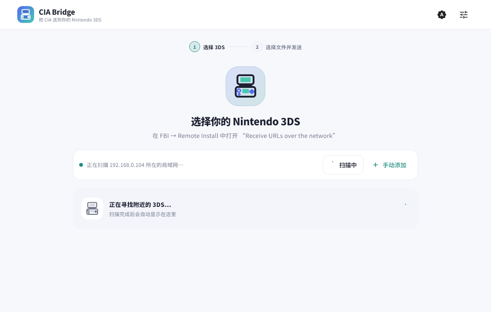

# CIA Bridge

English | [简体中文](README.zh-CN.md)

CIA Bridge is a modern LAN sender for FBI Remote Install on Nintendo 3DS. It runs on Windows and Android, serves files directly from your device, and can either push their local URLs to FBI or generate a QR code. Files stay on your local network and are never uploaded to a cloud service.



## Highlights

- One two-stage flow on Windows and Android: choose a 3DS, then choose files and send.
- Exact receive-state discovery with the compatible [FBI-curl fork](https://github.com/nicedayzhu/FBI), plus Nintendo OUI, safe Android candidate, and manual-IP fallbacks.
- Direct streaming from Windows files and Android `content://` URIs without loading an entire CIA into memory.
- Offline CIA details such as title icon, localized name, Title ID, version, region, and content type.
- FBI push and QR-code installation for `.cia`, `.tik`, `.cetk`, and `.3dsx` files.
- Luma3DS patch ZIP detection by Title ID, including `code.ips` and `romfs`, with negotiated per-file compression, CRC32 verification, and incremental writes that skip unchanged content.
- Android foreground transfers and a native Windows build with no Java or JRE dependency.

CIA details come from the file's TMD and optional SMDH metadata. Metadata errors never make the file unsendable. Patch names use the detected Title ID and the bundled offline catalog; only an unknown ID may trigger a small, non-blocking lookup.

## Download

Download the current Windows x64 portable package or Android APK from [GitHub Releases](https://github.com/nicedayzhu/cia-bridge/releases/latest).

| Platform | Package | Notes |
| --- | --- | --- |
| Windows x64 | `CIA-Bridge-v<version>-Windows-x64.zip` | Extract the complete archive and run `cia_bridge.exe`. |
| Android 7.0+ | `CIA-Bridge-v<version>-Android.apk` | Side-load the APK. GitHub Release packages use the project's persistent release certificate. |

The Windows executable must remain beside its `data` directory and Flutter runtime files. Do not copy only the `.exe`.

## Quick start

### Push URLs to FBI

1. Connect the computer or phone and the 3DS to the same Wi-Fi or LAN.
2. On the 3DS, open `FBI → Remote Install → Receive URLs over the network`.
3. In CIA Bridge, select the receiver marked **FBI ready**. With an older FBI build, select the Nintendo device or compare a candidate with the IP shown on FBI's screen.
4. Select one or more supported files and choose **Send to 3DS**.
5. Confirm the installation in FBI and keep CIA Bridge running until the transfer completes.

### Scan a QR code

1. Select a local installation file in CIA Bridge.
2. Choose the QR-code installation option and generate the LAN QR code.
3. On the 3DS, open `FBI → Remote Install → Scan QR Code`.
4. Scan and confirm the installation. Keep CIA Bridge running while FBI downloads the file.

### Stream a LayeredFS localization patch (Windows and Android)

1. Select one ZIP containing `luma/titles/<16-digit Title ID>/...`. Both `code.ips` and `romfs/...` are supported. Outer wrapper folders and README files are allowed; one selection must contain only one Title ID.
2. On the 3DS, open **FBI → Remote Install → Receive URLs over the network**. A compatible receiver advertises both the install and patch ports.
3. Review the detected game, Title ID, and file count in CIA Bridge, send the patch, and confirm on the 3DS.

The receiver preserves files absent from the ZIP and skips SD writes for identical content. If a transfer is interrupted, send the same ZIP again so the receiver can verify and repair the result.

## Device discovery limits

The CIA Bridge-compatible [FBI-curl fork](https://github.com/nicedayzhu/FBI) replies to a small versioned UDP discovery request only while its network receiver is open. CIA Bridge therefore knows both that the target is a 3DS and that FBI is ready, on Windows and Android. The wire format is documented in [the discovery protocol specification](docs/DISCOVERY_PROTOCOL.md).

Stock and older FBI builds do not advertise their receive state. CIA Bridge remains compatible: on systems that expose the neighbor table, it follows Boop's non-destructive approach and identifies Nintendo hardware by MAC OUI.

Modern Android restricts access to other LAN devices' MAC addresses. CIA Bridge therefore falls back to a safe reachability scan of the local `/24` subnet and labels the results as candidates. A candidate is not proof that the device is a Nintendo 3DS or that FBI is waiting; compare it with the IP shown by FBI.

CIA Bridge never opens TCP/5000 merely to probe a device. FBI accepts such a connection as a transfer request and would report an error when the expected four-byte payload length does not arrive.

## Build

Requirements:

- Flutter 3.47.9 or a compatible stable Flutter SDK.
- Visual Studio with Desktop development with C++ for Windows builds.
- Android SDK and JDK 17 for Android builds.

From PowerShell:

```powershell
.\scripts\build-all.ps1 -Clean
```

Set `CIA_BRIDGE_FLUTTER`, `ANDROID_HOME`, and `JAVA_HOME` when the tools are not in their default locations. Use `-SkipWindows` or `-SkipAndroid` to build only one target. The script runs dependency resolution, static analysis, tests, both release builds, and packages the results under `dist/`.

Without Android release credentials, the local script explicitly names its APK
`CIA-Bridge-v<version>-Android-local-test.apk`; it is for testing only. The GitHub Release
workflow requires the persistent release key and produces the upgradable,
officially signed package.

## Documentation

- Architecture: [English](docs/ARCHITECTURE.en.md) · [简体中文](docs/ARCHITECTURE.md)
- Protocols: [FBI Remote Install](docs/FBI_PROTOCOL.en.md) · [device discovery](docs/DISCOVERY_PROTOCOL.md) · [CBPATCH1 patch streaming](docs/PATCH_PROTOCOL.md)
- Maintainer notes: [patch performance](docs/PATCH_PERFORMANCE.md) · [release process](docs/RELEASING.md)
- [Third-party notices](THIRD_PARTY_NOTICES.md)

## Security and legal use

- The temporary HTTP server starts only after an explicit share action and binds to the selected LAN IPv4 address.
- Each session receives a random URL token; links become invalid when the server stops.
- LAN transfer uses plain HTTP. Do not use CIA Bridge on an untrusted public network.
- When a patch Title ID is absent from the bundled catalog, CIA Bridge may send
  only that Title ID to `api.nlib.cc` to look up a display name. Failure is
  ignored and never blocks local packaging or transfer.
- CIA Bridge does not provide copyrighted software, download catalogs, or title sources. Use it only for content you are authorized to install and for homebrew.
- The current application interface is Simplified Chinese; the project documentation is bilingual.

## Acknowledgements

The interaction model is inspired by [LocalSend](https://github.com/localsend/localsend). Nintendo OUI discovery follows the approach used by [Boop](https://github.com/miltoncandelero/Boop). CIA Bridge is not affiliated with Nintendo or the FBI project.

## License

CIA Bridge is released under the [MIT License](LICENSE). Third-party components retain their own licenses; see [THIRD_PARTY_NOTICES.md](THIRD_PARTY_NOTICES.md).
