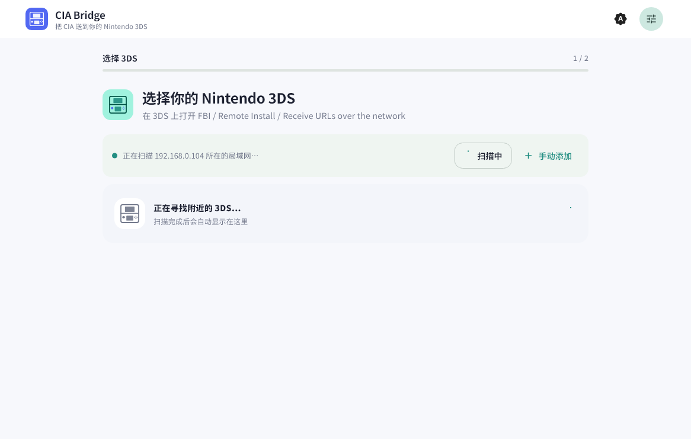

# CIA Bridge

[English](README.md) | 简体中文

CIA Bridge 是一款面向 Nintendo 3DS FBI Remote Install 的现代局域网投送工具，支持 Windows 与 Android。它直接从电脑或手机提供本地文件，通过网络把 URL 推送给 FBI，或生成供 FBI 扫描的二维码。文件只在局域网内传输，不会上传到云端。



## 主要功能

- Windows 与 Android 使用同一套两阶段流程：先选择 3DS，再选择文件并发送。
- 配合 [CIA Bridge 版 FBI-curl](https://github.com/nicedayzhu/FBI) 精确发现接收状态，并保留 Nintendo OUI、Android 在线候选和手动 IP 回退。
- 直接流式读取 Windows 文件和 Android `content://` URI，不把完整 CIA 载入内存。
- 离线显示 CIA 图标、名称、Title ID、版本、区域和内容类型等信息。
- 支持 `.cia`、`.tik`、`.cetk`、`.3dsx` 的 FBI 推送与二维码安装。
- 按 Title ID 识别 LayeredFS 补丁 ZIP，采用确定性流、CRC32 校验和跳过相同内容的增量写入。
- Android 支持前台传输；Windows 为不依赖 Java 或 JRE 的原生程序。

CIA 信息来自文件的 TMD 与可选 SMDH 元数据，解析失败不会阻止发送。补丁名称优先使用内置离线目录；只有未知 Title ID 才会进行一次不影响打包和传输的可选查询。

## 下载

从 [GitHub Releases](https://github.com/nicedayzhu/cia-bridge/releases/latest) 下载最新的 Windows x64 便携包或 Android APK。

| 平台 | 文件 | 说明 |
| --- | --- | --- |
| Windows x64 | `CIA-Bridge-v<版本>-Windows-x64.zip` | 完整解压后运行 `cia_bridge.exe`。 |
| Android 7.0+ | `CIA-Bridge-v<版本>-Android.apk` | 侧载安装；GitHub Release 正式包使用项目固定的 release 签名证书。 |

Windows 可执行文件必须与 `data` 目录和 Flutter 运行库保持在一起，不能只复制 `.exe`。

## 快速使用

### 主动推送给 FBI

1. 让电脑或手机与 3DS 连接同一个 Wi-Fi 或局域网。
2. 在 3DS 打开 `FBI → Remote Install → Receive URLs over the network`。
3. 在 CIA Bridge 中选择标有“FBI 就绪”的设备。若使用旧版 FBI，则选择发现的 Nintendo 设备；显示候选时，请与 FBI 屏幕 IP 核对。
4. 选择一个或多个支持的文件，然后点击“发送到 3DS”。
5. 在 FBI 中确认安装，传输完成前保持 CIA Bridge 运行。

### 扫描二维码

1. 在 CIA Bridge 中选择本地安装文件。
2. 选择二维码安装并生成局域网二维码。
3. 在 3DS 打开 `FBI → Remote Install → Scan QR Code`。
4. 扫码并确认安装；FBI 下载期间保持 CIA Bridge 运行。

### 流式发送 LayeredFS 汉化补丁（Windows 与 Android）

1. 选择一个包含 `luma/titles/<16 位 Title ID>/romfs/...` 的 ZIP。允许外层包装目录和 README，但一次选择只能包含一个 Title ID。
2. 在 3DS 打开 `FBI → Remote Install → Receive URLs over the network`；兼容接收端会同时公布安装与补丁端口。
3. 在 CIA Bridge 核对游戏名、Title ID 和文件数量，发送后在 3DS 确认。

接收端会保留 ZIP 未包含的旧文件，并跳过内容相同文件的 SD 写入。传输若中断，重新发送同一 ZIP 即可继续校验和修复。

## 自动发现的边界

[CIA Bridge 版 FBI-curl](https://github.com/nicedayzhu/FBI) 仅在网络接收界面打开时回应一个轻量、带版本号的 UDP 发现请求。因此 Windows 和 Android 都能同时确认目标是 3DS，并确认 FBI 正在等待接收。报文格式见[自动发现协议](docs/DISCOVERY_PROTOCOL.md)。

原版和旧版 FBI 不会公布接收状态，但 CIA Bridge 仍然兼容：在允许读取邻居表的系统上，程序继续采用与 Boop 相同的非破坏性思路，通过 MAC OUI 识别 Nintendo 硬件。

现代 Android 会限制普通应用读取其他局域网设备的 MAC。因此 CIA Bridge 会降级为安全扫描本地 `/24` 网段中的可达地址，并把结果标记为候选。候选不代表已经确认是 Nintendo 3DS，也不代表 FBI 正在等待接收，请与 FBI 屏幕显示的 IP 核对。

CIA Bridge 不会为了探测设备而连接 TCP/5000。FBI 会把这种连接当作传输请求；如果随后收不到四字节载荷长度，就会在 3DS 上报告错误。

## 构建

需要：

- Flutter 3.47.9 或兼容的稳定版 Flutter SDK。
- 构建 Windows 时需要带“使用 C++ 的桌面开发”的 Visual Studio。
- 构建 Android 时需要 Android SDK 和 JDK 17。

在 PowerShell 中运行：

```powershell
.\scripts\build-all.ps1 -Clean
```

工具不在默认位置时，可设置 `CIA_BRIDGE_FLUTTER`、`ANDROID_HOME` 和 `JAVA_HOME`。可用 `-SkipWindows` 或 `-SkipAndroid` 只构建一个平台。脚本会完成依赖解析、静态分析、测试、两个平台的 release 构建，并把结果整理到 `dist/`。

本地未提供 Android 发布密钥时，脚本会把 APK 明确命名为 `CIA-Bridge-v<版本>-Android-local-test.apk`，该包仅用于测试；GitHub Release 工作流要求固定发布密钥，并生成可持续升级的正式签名包。

## 文档

- 架构：[简体中文](docs/ARCHITECTURE.md) · [English](docs/ARCHITECTURE.en.md)
- 协议：[FBI Remote Install](docs/FBI_PROTOCOL.md) · [设备发现](docs/DISCOVERY_PROTOCOL.md) · [CBPATCH1 补丁流](docs/PATCH_PROTOCOL.md)
- 维护说明：[补丁性能设计](docs/PATCH_PERFORMANCE.md) · [发布流程](docs/RELEASING.md)
- [第三方组件说明](THIRD_PARTY_NOTICES.md)

## 安全与合法使用

- 只有用户明确开始共享后，临时 HTTP 服务才会监听所选局域网 IPv4 地址。
- 每个会话都会生成随机 URL 令牌；服务停止后链接立即失效。
- 局域网传输使用明文 HTTP，请勿在不可信的公共网络使用。
- 当补丁 Title ID 不在内置数据库中时，CIA Bridge 可能只把这个 Title ID
  发送给 `api.nlib.cc` 查询显示名称；查询失败会被忽略，不会阻止本地打包或传输。
- CIA Bridge 不提供受版权保护的软件、下载目录或资源来源，只应用于用户有权安装的内容和自制软件。
- 当前应用界面为简体中文，项目文档提供中英文版本。

## 致谢

交互模型受到 [LocalSend](https://github.com/localsend/localsend) 启发；Nintendo OUI 自动发现参考 [Boop](https://github.com/miltoncandelero/Boop)。CIA Bridge 与 Nintendo 或 FBI 项目没有隶属关系。

## 许可证

CIA Bridge 使用 [MIT License](LICENSE)。第三方组件保留各自许可证，详见 [THIRD_PARTY_NOTICES.md](THIRD_PARTY_NOTICES.md)。
